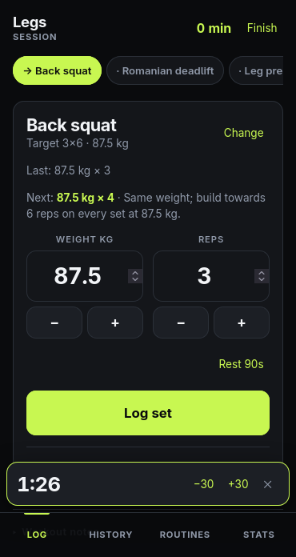
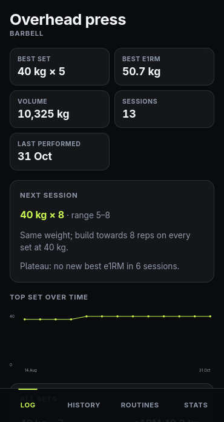
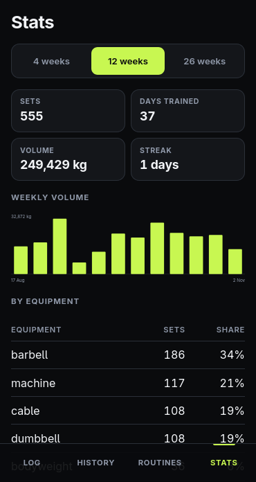

# Gym tracker

**TypeScript · Nuxt 4 / Nitro · Postgres · Drizzle · Better Auth · Railway**

[Source](https://github.com/porteightyeighty/gym-tracker)

 

A workout log I built for myself, because I didn't want my training data on a paid service that
uses health data. It records sessions, routines, sets, cardio and body weight, and shows progress
for each exercise. It's single-user and holds my own data, so there's no public demo. The
screenshots use generated data.

## Analysis worker

The app shows personal records, marks an exercise as plateaued, and suggests a target for the next
session. These depend on an exercise's whole history, which changes when I edit, move or delete a
past session. To keep that work out of the request, it's done by a separate worker.

- **Outbox.** Any route that changes past sessions also writes an event to an `outbox` table in
  the same transaction, so an event exists only if the change was saved.
- **Recalculating from scratch.** An event only says which exercises changed. The worker
  recalculates those exercises from all their sets and replaces the stored results. Because of
  that, processing an event twice, or in the wrong order, gives the same result, and all the
  results can be rebuilt with one command when I change a rule.
- **Postgres as the queue.** The worker claims up to 10 events at a time with
  `FOR UPDATE SKIP LOCKED`. If it crashes, the transaction rolls back and the events are picked up
  again. Failing events are retried with increasing delays and set aside after five attempts.

If the worker is down, the app still works, and the results catch up when it restarts.

## Other decisions

- **Single-user.** There's no `user_id` column and no signup. Adding users later would mean a
  migration and a filter on every query.
- **Timezones.** Timestamps are stored in UTC, but grouping by UTC date put evening sessions on the
  wrong day, so the stats are grouped in the browser's timezone.
- **Auth.** Every data route starts with the same session check.
- **Infrastructure as code.** The Railway setup is defined in a TypeScript file. At one point
  Railway put the database in San Francisco while the app ran in Europe, which made every page
  take 1 to 5 seconds. Moving it fixed that, and the region is now set in the file.

## Testing

- `npm run check` runs plain assertions over the validation, analysis rules and stats code.
- Integration tests run the built server and worker against Postgres. They check that a failed
  request leaves no event behind, that processing an event twice changes nothing, that a worker
  killed mid-batch has its events picked up by another, and that rebuilding from scratch matches
  processing events one at a time.
- CI runs both on every push to main and every pull request.

## Next steps

- Use Postgres `LISTEN/NOTIFY` so the worker doesn't have to poll.
- Make the suggested rep range depend on the exercise. The default of 8–12 is too high for heavy
  lifts.
- Add password reset.
